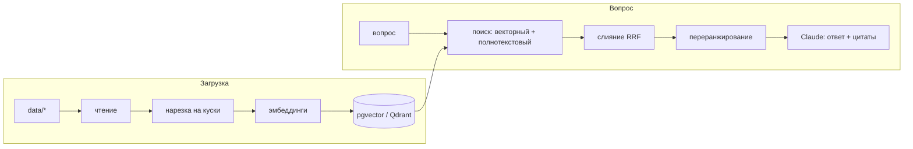

# rag-lab

Практическая лаборатория по Retrieval-Augmented Generation (RAG), собранная так, как я
строю продакшн-бэкенды: FastAPI, PostgreSQL, Docker, тесты и CI с первого дня.

Цель — честно разобраться в RAG, собирая его небольшими измеримыми шагами: нарезка текста
на куски (чанкинг), эмбеддинги, векторный поиск в pgvector и Qdrant, гибридный поиск
и переранжирование, ответы Claude со ссылками на источники, тот же пайплайн на LangChain
и LlamaIndex, оценка качества (evals), вызов инструментов (tool calling) и MCP-сервер.
У каждого этапа ниже есть чек-лист, ссылки на официальную документацию и проверяемый
критерий «готово».

**Статус:** этап 3. `/ingest` загружает корпус и считает векторы; `/search` ищет в трёх режимах
(vector, hybrid, rerank); `/ask` отвечает `501`, пока не сделан этап 4.

## Стек

| Слой | Выбор |
|---|---|
| API | Python 3.12, FastAPI, Pydantic Settings |
| Хранилище | PostgreSQL 16 + pgvector 0.8.7 (Docker), схема на SQLAlchemy 2.0 + миграции Alembic, Qdrant 1.20 (этап 6) |
| Эмбеддинги | sentence-transformers локально, мультиязычная модель `intfloat/multilingual-e5-small` (этап 2); API-эмбеддинги по желанию |
| LLM | Claude через официальный Python SDK `anthropic`, модель по умолчанию `claude-sonnet-5-5` |
| Фреймворки | LangChain (LCEL) и LlamaIndex для сравнения (этап 5) |
| Качество | Свой набор вопросов: recall@k, MRR, LLM-as-judge; ragas по желанию (этап 7) |
| Инструменты | uv, ruff, pytest, GitHub Actions |

## Как всё связано



**Загрузка:** документ режется на куски по ~800 символов, каждый кусок превращается
в вектор и вместе с текстом сохраняется в Postgres.
**Вопрос:** вопрос тоже превращается в вектор, в базе ищутся ближайшие куски, Claude
получает их как контекст и отвечает со ссылками на них.

**Языки.** Документы в `data/` на английском (это оригинальная документация), вопросы
и ответы на русском. Получается кросс-языковой поиск, поэтому модель эмбеддингов
и переранжировщик должны быть мультиязычными.

## Быстрый старт

Нужны [uv](https://docs.astral.sh/uv/) и Docker.

```bash
cp .env.example .env
docker compose up -d            # Postgres 16 + pgvector, ждёт healthcheck
uv sync                         # создаёт .venv по uv.lock
uv run alembic upgrade head     # схема базы (расширение vector, таблицы, индекс HNSW)
uv run uvicorn app.main:app --reload
```

```bash
curl localhost:8000/health      # {"status":"ok","version":"0.1.0"}
curl localhost:8000/ready       # {"status":"ready","pgvector":"0.8.7"}
curl -X POST localhost:8000/ingest
# {"written":5,"unchanged":0,"deleted":0,"chunks":206,"embedded":206}
# повторный вызов: written 0, unchanged 5, embedded 0. Первый запуск качает модель (~500 МБ).
curl -X POST localhost:8000/search -H 'content-type: application/json' \
  -d '{"query": "Какие типы индексов поддерживает pgvector?", "k": 5, "mode": "rerank"}'
```

Схема описана в `app/models.py`; после изменения модели миграция генерируется и применяется так:

```bash
uv run alembic revision --autogenerate -m "что изменилось" && uv run alembic upgrade head
```

Проверки (те же, что запускает CI):

```bash
uv run ruff check . && uv run ruff format --check . && uv run pytest
```

Интеграционные тесты создают отдельную базу `rag_test` в том же Postgres и накатывают на неё
миграции. Если Postgres не запущен, они пропускаются; в CI они обязательны.

Qdrant для этапа 6: `docker compose --profile qdrant up -d`.

## Структура

```
app/
  main.py          FastAPI: /health, /ready, /ingest, /search, /ask
  config.py        настройки из переменных окружения и .env
  models.py        схема базы (SQLAlchemy 2.0), источник правды для миграций
  db.py            подключение к Postgres
  schemas.py       модели запросов и ответов (контракт API)
  rag/
    loader.py      чтение корпуса по manifest.json
    chunking.py    нарезка на куски
    ingest.py      идемпотентная загрузка документов и кусков, расчёт недостающих векторов
    embeddings.py  LocalEmbedder: sentence-transformers, префиксы query:/passage:
    retrieval.py   векторный и полнотекстовый поиск, RRF, cross-encoder
    store.py, generation.py   заготовки этапов 4 и 6
alembic/           миграции Alembic (env.py берёт DATABASE_URL из настроек)
data/              учебный корпус + manifest.json (см. data/README.md)
evals/             вопросы для оценки качества (формат в questions.example.jsonl)
scripts/           fetch_data.py скачивает корпус
docs/notes.md      дневник обучения, запись на каждый этап
tests/
```

## План (roadmap)

Этапы идут по порядку. После каждого — короткая запись в [`docs/notes.md`](docs/notes.md):
что сделал, какие цифры получил, что удивило. Библиотеки этапа ставь, когда до него
дошёл (`uv add ...`), чтобы в `pyproject.toml` были только реально используемые зависимости.
Официальная документация почти везде только на английском.

### Этап 0. Окружение

- [x] Проект на uv, ruff, pytest, GitHub Actions
- [x] `docker compose` с Postgres 16 + pgvector, healthcheck, init-скрипт
- [x] FastAPI с `/health` (жив ли процесс) и `/ready` (доступны ли Postgres и pgvector)
- [x] Запустить самому: `docker compose up -d`, `/ready` возвращает версию pgvector
- [x] Подключиться через `psql` и выполнить `\dx`; построчно разобрать `docker-compose.yml` и первую миграцию в `alembic/versions/`
- [x] CI зелёный на GitHub

Документация: [uv: проекты](https://docs.astral.sh/uv/concepts/projects/) ·
[Docker Compose](https://docs.docker.com/compose/) ·
[pgvector](https://github.com/pgvector/pgvector) ·
[FastAPI: первые шаги](https://fastapi.tiangolo.com/tutorial/first-steps/)

**Готово, когда** свежий клон запускается командами из «Быстрого старта» и ничем больше,
а CI проходит.

### Этап 1. Загрузка и нарезка документов

- [x] Загрузчик `.md`, `.rst`, `.txt`, который сохраняет метаданные (`file`, `title`, `url` из `data/manifest.json`)
- [x] Нарезка фиксированного размера с перекрытием в `app/rag/chunking.py`
- [ ] Рекурсивная нарезка (заголовки → абзацы → предложения), не резать внутри блоков кода
- [x] Таблицы `documents` и `chunks` (`app/models.py` + миграция Alembic), хеш содержимого у каждого документа
- [x] `POST /ingest` сохраняет документы и куски идемпотентно; юнит-тесты на нарезку, интеграционные на загрузку

Документация: [Contextual Retrieval (Anthropic)](https://www.anthropic.com/research/contextual-retrieval) ·
[LangChain: text splitters](https://docs.langchain.com/oss/python/integrations/splitters) ·
[PostgreSQL: типы JSON](https://www.postgresql.org/docs/16/datatype-json.html) ·
[PostgreSQL: ограничения](https://www.postgresql.org/docs/16/ddl-constraints.html)

**Готово, когда** `POST /ingest` загружает все пять документов, размер куска и перекрытие
берутся из настроек, повторная загрузка неизменённых файлов ничего не пишет, а тесты
нарезки покрывают перекрытие, пустой вход и границу куска внутри блока кода.

### Этап 2. Эмбеддинги и pgvector

- [x] `uv add sentence-transformers`; `LocalEmbedder` (`intfloat/multilingual-e5-small`, 384 измерения) за протоколом `Embedder`
- [x] У e5 есть правило: к вопросам добавлять префикс `query: `, к кускам документов — `passage: `
- [x] Колонка `chunks.embedding vector(384)` + индекс HNSW с `vector_cosine_ops` (в той же миграции)
- [x] Эмбеддинги считаются пачками; пересчитываются только новые куски и куски от другой модели (`embedding_model` хранится рядом с вектором)
- [ ] По желанию: эмбеддинги через API (например, Voyage AI) за тем же протоколом; сравнить на этапе 7

Документация: [Sentence Transformers: быстрый старт](https://sbert.net/docs/quickstart.html) ·
[pgvector-python](https://github.com/pgvector/pgvector-python) ·
[pgvector: HNSW](https://github.com/pgvector/pgvector#hnsw) ·
[Эмбеддинги (документация Claude)](https://platform.claude.com/docs/en/build-with-claude/embeddings)

**Готово, когда** у каждого куска есть эмбеддинг, индекс HNSW создан, скорость расчёта
(кусков в секунду) записана в `docs/notes.md`, а смена модели запускает пересчёт.

### Этап 3. Поиск: векторный, гибридный, с переранжированием

- [x] `mode=vector`: косинусное расстояние (`<=>`) в pgvector, top-k с оценками
- [x] `mode=hybrid`: полнотекстовый поиск Postgres (`tsvector`, `ts_rank_cd`) + векторный, слияние через Reciprocal Rank Fusion (RRF)
- [x] `mode=rerank`: top-30 гибридного поиска пересортировывает мультиязычный cross-encoder (`cross-encoder/mmarco-mMiniLMv2-L12-H384-v1`, посильнее — `BAAI/bge-reranker-v2-m3`)
- [ ] `EXPLAIN ANALYZE` показывает, что используется индекс HNSW; медианная задержка (p50) каждого режима в `docs/notes.md`

Документация: [PostgreSQL: ранжирование результатов поиска](https://www.postgresql.org/docs/16/textsearch-controls.html) ·
[pgvector-python: пример RRF](https://github.com/pgvector/pgvector-python/blob/master/examples/hybrid_search/rrf.py) ·
[Cross-encoder: использование](https://sbert.net/docs/cross_encoder/usage/usage.html)

**Готово, когда** `POST /search` поддерживает все три режима, у RRF есть юнит-тест, и на
одном примере ты можешь объяснить, почему гибридный поиск нашёл то, что векторный
пропустил (или наоборот).
Учти: полнотекстовый поиск Postgres ищет по словам, а русский вопрос не совпадёт
по словам с английским текстом. Значит, лексическая часть сработает только на
общих терминах (`HNSW`, `asyncio`, `CREATE INDEX`). Хорошая тема для заметок.
Ещё учти: `ts_rank_cd` — это не BM25; отметь это или попробуй `rank-bm25` в Python.

### Этап 4. Генерация ответа через Claude

- [ ] Задать `ANTHROPIC_API_KEY`; клиент из официального SDK `anthropic`
- [ ] Каждый найденный кусок передаётся как content block типа `document` с включёнными цитатами; модель из `LLM_MODEL` (`claude-sonnet-5-5`)
- [ ] Ответ на языке вопроса (на русском), цитаты — дословно из английского источника
- [ ] `POST /ask` возвращает `answer` + `citations` (документ, id куска, цитата)
- [ ] Модель говорит «не знаю», если в контексте нет ответа; обработка `stop_reason` (`max_tokens`, `refusal`); логирование расхода токенов

Документация: [Messages API](https://platform.claude.com/docs/en/build-with-claude/working-with-messages) ·
[Citations](https://platform.claude.com/docs/en/build-with-claude/citations) ·
[Обзор моделей](https://platform.claude.com/docs/en/about-claude/models/overview) ·
[Python SDK](https://github.com/anthropics/anthropic-sdk-python)

**Готово, когда** три вопроса из `evals/questions.example.jsonl` получают верные ответы
с цитатами, вопрос не по теме получает «не знаю», а ошибки API превращаются в понятные
HTTP-ошибки (429 и 5xx от Claude — это не твой 500).

### Этап 5. Тот же пайплайн на LangChain и LlamaIndex

- [ ] LangChain: хранилище `PGVector` + `ChatAnthropic`, цепочка поиска на LCEL (runnables)
- [ ] LlamaIndex: `PGVectorStore` + Anthropic LLM, query engine поверх `VectorStoreIndex`
- [ ] `POST /ask` принимает `engine=plain|langchain|llamaindex`, формат ответа одинаковый
- [ ] `docs/comparison.md`: строки кода, задержка, что каждый фреймворк прячет, качество поиска (перемерить после этапа 7)

Документация: [LangChain: обзор](https://docs.langchain.com/oss/python/langchain/overview) ·
[LangChain: runnables (LCEL)](https://reference.langchain.com/python/langchain-core/runnables) ·
[LangChain: PGVector](https://docs.langchain.com/oss/python/integrations/vectorstores/pgvector) ·
[LlamaIndex: Postgres vector store](https://developers.llamaindex.ai/python/framework/integrations/vector_stores/postgres/)

**Готово, когда** все три движка отвечают на примерные вопросы, а в сравнении есть
обоснованная рекомендация: когда брать фреймворк, а когда лучше простой код.

### Этап 6. Qdrant как вторая векторная база

- [ ] `docker compose --profile qdrant up -d`; `uv add qdrant-client`
- [ ] `QdrantStore` реализует протокол `VectorStore`; переключение `VECTOR_BACKEND=pgvector|qdrant`
- [ ] Фильтры по payload (например, поиск только в одном документе); гибридный запрос Qdrant (dense + sparse)
- [ ] Заметки: pgvector или Qdrant для такой задачи (эксплуатация, фильтры, масштаб, стоимость)

Документация: [Qdrant: быстрый старт](https://qdrant.tech/documentation/quickstart/) ·
[Qdrant: фильтрация](https://qdrant.tech/documentation/search/filtering/) ·
[Qdrant: гибридные запросы](https://qdrant.tech/documentation/search/hybrid-queries/)

**Готово, когда** API работает без изменений на обеих базах, а метрики этапа 7 на них
отличаются максимум на несколько пунктов (или разница объяснена).

### Этап 7. Оценка качества (evals)

- [ ] `evals/questions.jsonl`: минимум 30 вопросов по корпусу с ожидаемыми документами/кусками и эталонными ответами, включая вопросы на несколько источников и вопросы без ответа в корпусе
- [ ] Метрики поиска: recall@k (нашёлся ли нужный кусок в первых k) и MRR (насколько высоко) для каждого режима поиска и настроек нарезки
- [ ] Метрики ответа: LLM-as-judge (другая модель оценивает ответ) на точность и опору на источники, с фиксированной рубрикой
- [ ] По желанию: `uv add ragas` и сравнить его оценки со своим судьёй
- [ ] CI считает метрики поиска (без вызовов LLM) и падает ниже порога

Документация: [Критерии успеха и evals (документация Claude)](https://platform.claude.com/docs/en/test-and-evaluate/develop-tests) ·
[Ragas](https://docs.ragas.io/en/stable/) ·
[Mean reciprocal rank](https://en.wikipedia.org/wiki/Mean_reciprocal_rank)

**Готово, когда** `uv run python -m evals.run` печатает таблицу результатов,
`evals/results.md` сравнивает минимум четыре конфигурации (размер куска; векторный,
гибридный или с переранжированием поиск), и каждое следующее изменение оценивается
этими цифрами.

### Этап 8. Tool calling и простой агент

- [ ] Инструменты: `search_docs(query, k, mode)`, `get_chunk(id)`, `list_documents()` со строгими JSON-схемами
- [ ] Цикл агента с Claude (`tool_choice: auto`), лимит шагов, ошибки инструментов возвращаются как `is_error`
- [ ] `POST /agent/ask` возвращает ответ и трассу вызовов инструментов
- [ ] Пять вопросов на несколько источников, где агент лучше одиночного `/ask` (замерить через этап 7)

Документация: [Tool use: обзор](https://platform.claude.com/docs/en/agents-and-tools/tool-use/overview) ·
[Описание инструментов](https://platform.claude.com/docs/en/agents-and-tools/tool-use/define-tools) ·
[Building effective agents](https://www.anthropic.com/research/building-effective-agents) ·
[LangChain: агенты](https://docs.langchain.com/oss/python/langchain/agents)

**Готово, когда** агент отвечает на вопросы, которые одиночный RAG пропускает, никогда
не выходит за лимит шагов, и каждый запуск можно пройти по шагам.

### Этап 9. MCP-сервер

- [ ] `uv add mcp`; `app/mcp_server.py` отдаёт `search_docs` как инструмент, а документы — как ресурсы
- [ ] Работает через stdio и Streamable HTTP
- [ ] Проверен в MCP Inspector, затем подключён к Claude Code или Claude Desktop

Документация: [Что такое MCP](https://modelcontextprotocol.io/docs/getting-started/intro) ·
[Build an MCP server](https://modelcontextprotocol.io/docs/develop/build-server) ·
[MCP Python SDK](https://github.com/modelcontextprotocol/python-sdk) ·
[MCP в Claude Code](https://code.claude.com/docs/en/mcp)

**Готово, когда** Claude Code отвечает на вопрос по корпусу, вызывая твой MCP-сервер,
а в README описано, как его подключить.

### Этап 10. Продакшн-штрихи

- [ ] Стриминг: `/ask` отдаёт токены по SSE
- [ ] Кэш: кэш эмбеддингов, кэш ответов по нормализованному вопросу + версии индекса; prompt caching для системного промпта
- [ ] Наблюдаемость: трейсы OpenTelemetry со спанами retrieve, rerank, generate; токены и задержка в атрибутах спанов; Jaeger как профиль compose
- [ ] Нагрузочный тест на Locust: p50/p95 и доля ошибок при фиксированном RPS, до и после кэша

Документация: [Стриминг (документация Claude)](https://platform.claude.com/docs/en/build-with-claude/streaming) ·
[Prompt caching](https://platform.claude.com/docs/en/build-with-claude/prompt-caching) ·
[OpenTelemetry Python](https://opentelemetry.io/docs/languages/python/) ·
[Locust](https://docs.locust.io/en/stable/)

**Готово, когда** один запрос виден целиком как трейс, отчёт нагрузочного теста лежит
в `docs/`, а доля попаданий в кэш и p95 замерены до и после.

## Данные

Учебный корпус — документация Python и PostgreSQL и README pgvector, всё под свободными
лицензиями. Источники и лицензии: [`data/README.md`](data/README.md).

## Лицензия

[MIT](LICENSE) (текст лицензии на английском, так принято). Файлы в `data/` сохраняют
свои исходные лицензии.
