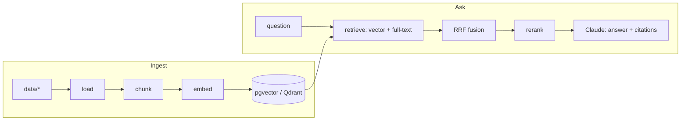

# rag-lab

A hands-on lab for Retrieval-Augmented Generation, built the way I build production
backends: FastAPI, PostgreSQL, Docker, tests and CI from day one.

The goal is to learn RAG properly by building it in small, measurable steps: chunking,
embeddings, vector search in pgvector and Qdrant, hybrid search and reranking, answers with
citations from Claude, the same pipeline in LangChain and LlamaIndex, evals, tool calling,
and an MCP server. Each stage below has a checklist, links to the official docs, and a
"done when" bar that can be checked.

**Status:** stage 0 (scaffold). `/health` and `/ready` work; `/ingest`, `/search` and `/ask`
return `501` until their stages are done.

## Stack

| Layer | Choice |
|---|---|
| API | Python 3.12, FastAPI, Pydantic Settings |
| Storage | PostgreSQL 16 + pgvector 0.8.7 (Docker), Qdrant 1.20 (stage 6) |
| Embeddings | sentence-transformers, local (stage 2); API embeddings optional |
| LLM | Claude via the Anthropic Python SDK, default model `claude-sonnet-5-5` |
| Frameworks | LangChain (LCEL), LlamaIndex (stage 5), for comparison |
| Quality | Own eval set: recall@k, MRR, LLM-as-judge; ragas optional (stage 7) |
| Tooling | uv, ruff, pytest, GitHub Actions |

## How it fits together



## Quick start

Prerequisites: [uv](https://docs.astral.sh/uv/) and Docker.

```bash
cp .env.example .env
docker compose up -d            # Postgres 16 + pgvector, waits for the healthcheck
uv sync                         # creates .venv from uv.lock
uv run uvicorn app.main:app --reload
```

```bash
curl localhost:8000/health      # {"status":"ok","version":"0.1.0"}
curl localhost:8000/ready       # {"status":"ready","pgvector":"0.8.7"}
```

Checks (the same ones CI runs):

```bash
uv run ruff check . && uv run ruff format --check . && uv run pytest
```

Qdrant for stage 6: `docker compose --profile qdrant up -d`.

## Layout

```
app/
  main.py          FastAPI app: /health, /ready, /ingest, /search, /ask
  config.py        settings from env / .env
  db.py            Postgres helpers
  schemas.py       request and response models (the API contract)
  rag/             chunking, embeddings, store, retrieval, generation (stubs to fill in)
data/              sample corpus + manifest.json (see data/README.md)
db/init/           SQL run on first Postgres start (CREATE EXTENSION vector)
evals/             eval questions (questions.example.jsonl shows the format)
scripts/           fetch_data.py downloads the corpus
docs/notes.md      learning log, one entry per stage
tests/
```

## Roadmap

Work through the stages in order. After each one, write a short entry in
[`docs/notes.md`](docs/notes.md): what you built, the numbers, what surprised you.
Install a stage's libraries when you get to it (`uv add ...`), so every dependency in
`pyproject.toml` is one you actually use.

### Stage 0. Environment

- [x] uv project, ruff, pytest, GitHub Actions
- [x] `docker compose` with Postgres 16 + pgvector, healthcheck, init script
- [x] FastAPI app with `/health` (liveness) and `/ready` (Postgres + pgvector check)
- [ ] Run it yourself: `docker compose up -d`, `/ready` returns the pgvector version
- [ ] Connect with `psql` and run `\dx`; read `docker-compose.yml` and `db/init/` line by line
- [ ] CI is green on GitHub

Docs: [uv projects](https://docs.astral.sh/uv/concepts/projects/) ·
[Docker Compose](https://docs.docker.com/compose/) ·
[pgvector](https://github.com/pgvector/pgvector) ·
[FastAPI first steps](https://fastapi.tiangolo.com/tutorial/first-steps/)

**Done when** a fresh clone runs with the Quick start commands and nothing else, and CI passes.

### Stage 1. Loading and chunking

- [ ] Loader for `.md`, `.rst`, `.txt` that keeps metadata (`file`, `title`, `url` from `data/manifest.json`)
- [ ] Fixed-size splitter with overlap in `app/rag/chunking.py`, then a recursive one (headings, paragraphs, sentences)
- [ ] Tables `documents` and `chunks` (SQL migration in `db/`), content hash per document
- [ ] `POST /ingest` stores documents and chunks; unit tests for the splitter

Docs: [Contextual Retrieval (Anthropic)](https://www.anthropic.com/research/contextual-retrieval) ·
[LangChain text splitters](https://docs.langchain.com/oss/python/integrations/splitters) ·
[PostgreSQL JSON types](https://www.postgresql.org/docs/16/datatype-json.html) ·
[PostgreSQL constraints](https://www.postgresql.org/docs/16/ddl-constraints.html)

**Done when** `POST /ingest` loads all five sample documents, chunk size and overlap come from
settings, re-ingesting unchanged files writes nothing, and splitter tests cover overlap, empty
input and a chunk boundary inside a code block.

### Stage 2. Embeddings and pgvector

- [ ] `uv add sentence-transformers`; `LocalEmbedder` (`all-MiniLM-L6-v2`, 384 dims) behind the `Embedder` protocol
- [ ] `chunks.embedding vector(384)` + HNSW index with `vector_cosine_ops`
- [ ] Embed in batches; only new or changed chunks get embedded
- [ ] Optional: an API embedder (e.g. Voyage AI) behind the same protocol; compare in stage 7

Docs: [Sentence Transformers quickstart](https://sbert.net/docs/quickstart.html) ·
[pgvector-python](https://github.com/pgvector/pgvector-python) ·
[pgvector HNSW](https://github.com/pgvector/pgvector#hnsw) ·
[Embeddings (Claude docs)](https://platform.claude.com/docs/en/build-with-claude/embeddings)

**Done when** every chunk has an embedding, the HNSW index exists, embedding throughput
(chunks/s) is written down in `docs/notes.md`, and changing the model name forces a re-embed.

### Stage 3. Retrieval: vector, hybrid, rerank

- [ ] `mode=vector`: cosine distance (`<=>`) over pgvector, top-k with scores
- [ ] `mode=hybrid`: Postgres full-text search (`tsvector`, `ts_rank_cd`) + vector, merged with Reciprocal Rank Fusion
- [ ] `mode=rerank`: hybrid top-50 re-scored by a cross-encoder (e.g. `cross-encoder/ms-marco-MiniLM-L6-v2`)
- [ ] `EXPLAIN ANALYZE` shows the HNSW index in use; p50 latency per mode in `docs/notes.md`

Docs: [PostgreSQL ranking search results](https://www.postgresql.org/docs/16/textsearch-controls.html) ·
[pgvector-python RRF example](https://github.com/pgvector/pgvector-python/blob/master/examples/hybrid_search/rrf.py) ·
[Cross-encoder usage](https://sbert.net/docs/cross_encoder/usage/usage.html)

**Done when** `POST /search` supports all three modes, RRF has a unit test, and you can explain
on one example query why hybrid found something vector search missed (or the other way round).
Note: Postgres `ts_rank_cd` is not BM25; say so in the notes, or try `rank-bm25` in Python.

### Stage 4. Answer generation with Claude

- [ ] Set `ANTHROPIC_API_KEY`; client from the official `anthropic` SDK
- [ ] Each retrieved chunk is a `document` content block with citations enabled; model from `LLM_MODEL` (`claude-sonnet-5-5`)
- [ ] `POST /ask` returns `answer` + `citations` (document, chunk id, quoted text)
- [ ] The model says it does not know when the context has no answer; handle `stop_reason` (`max_tokens`, `refusal`); log token usage

Docs: [Messages API](https://platform.claude.com/docs/en/build-with-claude/working-with-messages) ·
[Citations](https://platform.claude.com/docs/en/build-with-claude/citations) ·
[Models overview](https://platform.claude.com/docs/en/about-claude/models/overview) ·
[Python SDK](https://github.com/anthropics/anthropic-sdk-python)

**Done when** the three example questions in `evals/questions.example.jsonl` get correct,
cited answers, an off-topic question gets "I don't know", and API errors map to clear HTTP
errors (429 and 5xx from Claude are not your 500).

### Stage 5. Same pipeline in LangChain and LlamaIndex

- [ ] LangChain: `PGVector` store + `ChatAnthropic`, retrieval chain written in LCEL (runnables)
- [ ] LlamaIndex: `PGVectorStore` + Anthropic LLM, `VectorStoreIndex` query engine
- [ ] `POST /ask` takes `engine=plain|langchain|llamaindex` with the same response shape
- [ ] `docs/comparison.md`: lines of code, latency, what each framework hides, retrieval quality (rerun after stage 7)

Docs: [LangChain overview](https://docs.langchain.com/oss/python/langchain/overview) ·
[LangChain runnables (LCEL)](https://reference.langchain.com/python/langchain-core/runnables) ·
[LangChain PGVector](https://docs.langchain.com/oss/python/integrations/vectorstores/pgvector) ·
[LlamaIndex Postgres vector store](https://developers.llamaindex.ai/python/framework/integrations/vector_stores/postgres/)

**Done when** all three engines answer the example questions, and the comparison doc gives a
reasoned recommendation for when to use a framework and when plain code is better.

### Stage 6. Qdrant as a second vector store

- [ ] `docker compose --profile qdrant up -d`; `uv add qdrant-client`
- [ ] `QdrantStore` implements the `VectorStore` protocol; `VECTOR_BACKEND=pgvector|qdrant`
- [ ] Payload filters (e.g. search only one document); Qdrant hybrid query (dense + sparse)
- [ ] Notes: pgvector vs Qdrant for this workload (ops, filtering, scale, cost)

Docs: [Qdrant quickstart](https://qdrant.tech/documentation/quickstart/) ·
[Qdrant filtering](https://qdrant.tech/documentation/search/filtering/) ·
[Qdrant hybrid queries](https://qdrant.tech/documentation/search/hybrid-queries/)

**Done when** the API works unchanged on both backends and stage 7 metrics on both are within a
few points of each other (or the difference is explained).

### Stage 7. Evals

- [ ] `evals/questions.jsonl`: at least 30 questions over the corpus with expected documents/chunks and reference answers, including multi-hop and unanswerable ones
- [ ] Retrieval metrics: recall@k and MRR for every search mode and chunking setting
- [ ] Answer metrics: LLM-as-judge for faithfulness and correctness, with a fixed rubric
- [ ] Optional: `uv add ragas` and compare its scores with your judge
- [ ] CI runs retrieval metrics (no LLM calls) and fails below a threshold

Docs: [Define success criteria and build evaluations (Claude docs)](https://platform.claude.com/docs/en/test-and-evaluate/develop-tests) ·
[Ragas](https://docs.ragas.io/en/stable/) ·
[Mean reciprocal rank](https://en.wikipedia.org/wiki/Mean_reciprocal_rank)

**Done when** `uv run python -m evals.run` prints a results table, `evals/results.md` compares
at least four configurations (chunk size, vector vs hybrid vs rerank), and every later change
is judged by these numbers.

### Stage 8. Tool calling and a simple agent

- [ ] Tools: `search_docs(query, k, mode)`, `get_chunk(id)`, `list_documents()`, with strict JSON schemas
- [ ] Agent loop with Claude (`tool_choice: auto`), a step limit, and tool errors returned as `is_error`
- [ ] `POST /agent/ask` returns the answer and the trace of tool calls
- [ ] Five multi-hop questions where the agent beats single-shot `/ask` (measured with stage 7)

Docs: [Tool use overview](https://platform.claude.com/docs/en/agents-and-tools/tool-use/overview) ·
[Define tools](https://platform.claude.com/docs/en/agents-and-tools/tool-use/define-tools) ·
[Building effective agents](https://www.anthropic.com/research/building-effective-agents) ·
[LangChain agents](https://docs.langchain.com/oss/python/langchain/agents)

**Done when** the agent answers multi-hop questions that single-shot RAG misses, never loops
past the step limit, and every run is traceable step by step.

### Stage 9. MCP server

- [ ] `uv add mcp`; `app/mcp_server.py` exposes `search_docs` as a tool and documents as resources
- [ ] Runs over stdio and Streamable HTTP
- [ ] Tested in MCP Inspector, then connected to Claude Code or Claude Desktop

Docs: [What is MCP](https://modelcontextprotocol.io/docs/getting-started/intro) ·
[Build an MCP server](https://modelcontextprotocol.io/docs/develop/build-server) ·
[MCP Python SDK](https://github.com/modelcontextprotocol/python-sdk) ·
[MCP in Claude Code](https://code.claude.com/docs/en/mcp)

**Done when** Claude Code answers a question about the corpus by calling your MCP server, and the
README shows how to connect it.

### Stage 10. Production touches

- [ ] Streaming: `/ask` streams tokens over SSE
- [ ] Caching: embedding cache, answer cache keyed by normalized question + index version; prompt caching for the system prompt
- [ ] Observability: OpenTelemetry traces with spans for retrieve, rerank, generate; token usage and latency as span attributes; Jaeger as a compose profile
- [ ] Load test with Locust: p50/p95 latency and error rate at a fixed RPS, before and after caching

Docs: [Streaming (Claude docs)](https://platform.claude.com/docs/en/build-with-claude/streaming) ·
[Prompt caching](https://platform.claude.com/docs/en/build-with-claude/prompt-caching) ·
[OpenTelemetry Python](https://opentelemetry.io/docs/languages/python/) ·
[Locust](https://docs.locust.io/en/stable/)

**Done when** one request is visible end to end as a trace, the load-test report is in
`docs/`, and cache hit rate and p95 latency are measured before and after.

## Data

The sample corpus is Python and PostgreSQL documentation plus the pgvector README, all under
permissive licenses. Sources and licenses: [`data/README.md`](data/README.md).

## License

[MIT](LICENSE). Files in `data/` keep their original licenses.
